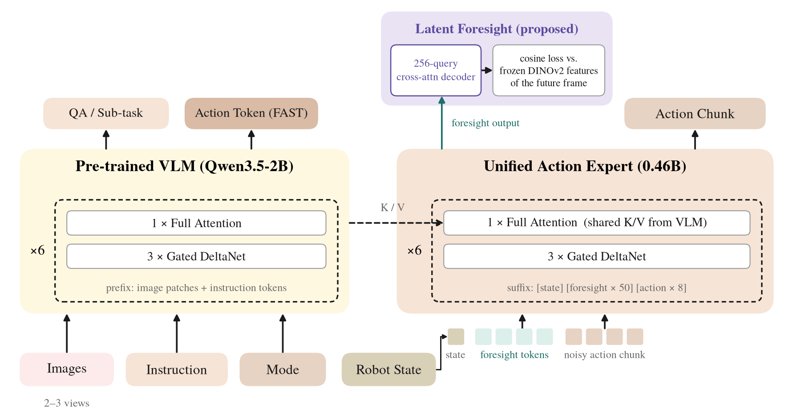
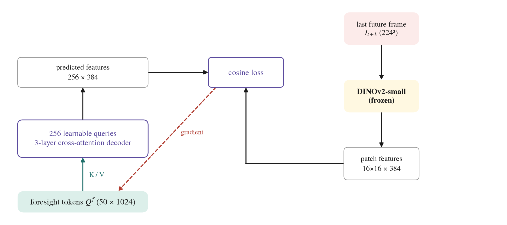
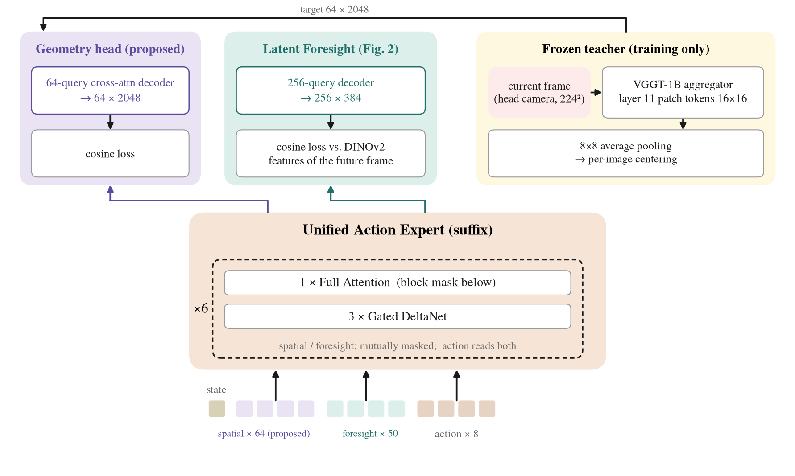
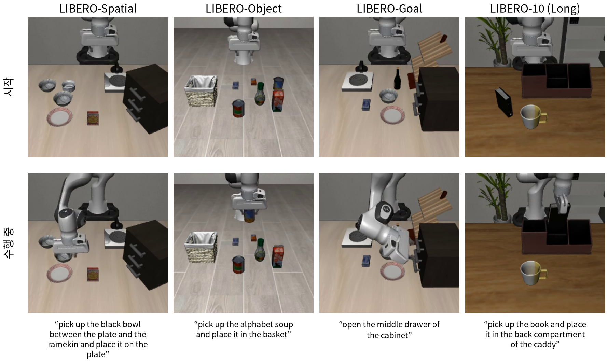
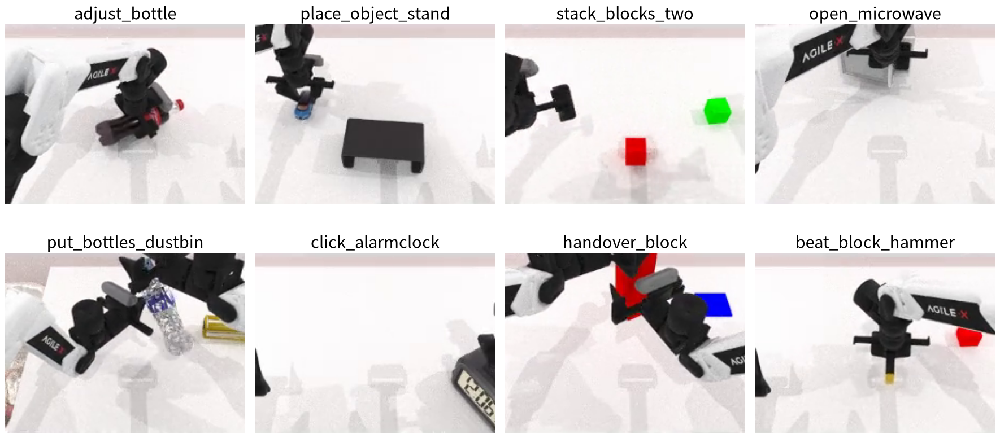
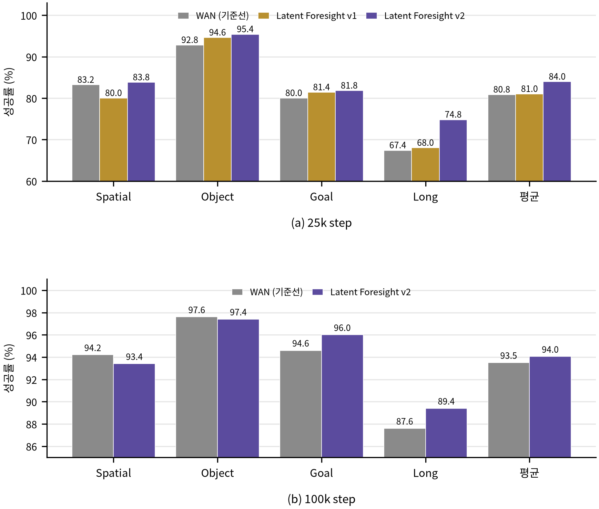
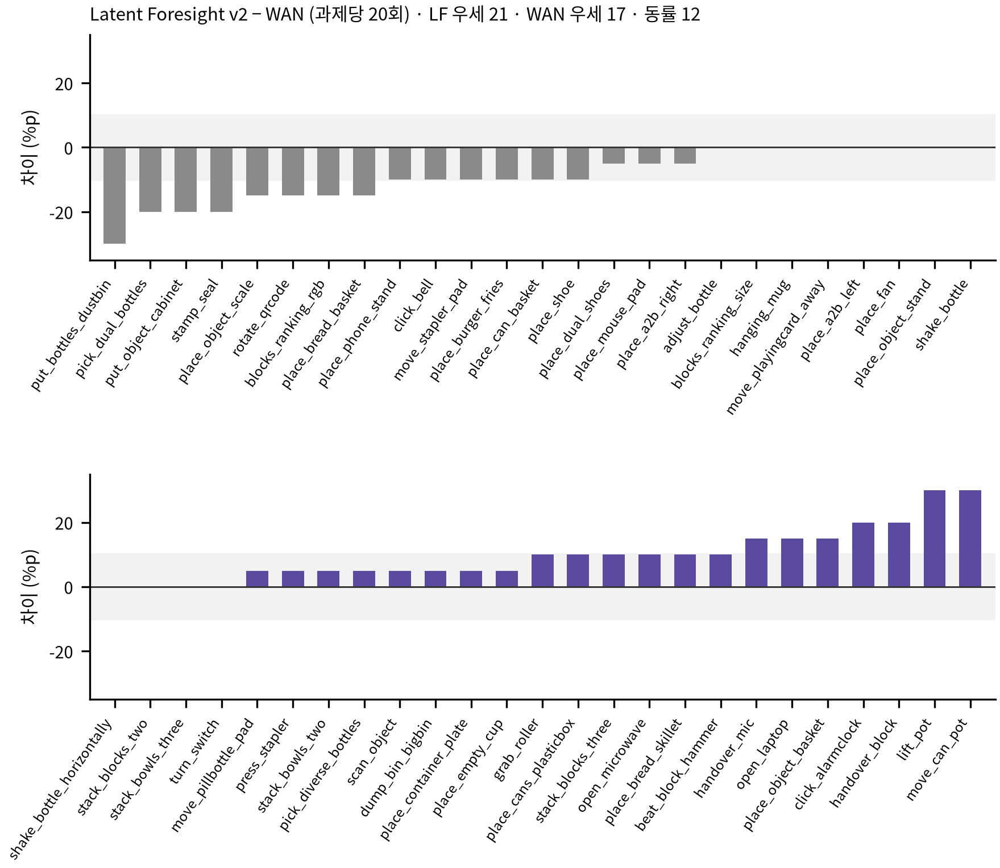

# Resource-Efficient Fine-Tuning of Vision-Language-Action Models by Replacing the Pixel World Model with Latent Feature Regression
**픽셀 세계모델을 잠재 특징 회귀로 대체한 비전-언어-행동 모델의 자원 효율적 미세조정**

Hyeon-Sung Choi, Jong-Eun Ha*  
Seoul National University of Science and Technology

> 🚀 This project is built on **[InternVLA-A1.5](https://github.com/InternRobotics/InternVLA-A-series)** (InternRobotics, 2026) and its LeRobot-based training code.  
> The original InternVLA-A1.5 README is kept at [`docs/README_InternVLA-A1.5.md`](docs/README_InternVLA-A1.5.md).

---

## Abstract

InternVLA-A1.5 grounds a vision-language-action (VLA) model in physical causality by predicting future frames with a frozen 5B video diffusion model, but this loss keeps 10 GB of frozen parameters resident and raises the estimated per-GPU memory to about 55 GB. We show that the optimizer states and the frozen video model, not the trainable parameters, dominate this budget. Without changing the model or losses, we fit the trainable model on a single RTX 3090 and place only the frozen video model on an auxiliary GPU. We then propose **Latent Foresight**, which removes the video diffusion model from the fine-tuning loss path: the foresight tokens are regressed onto frozen DINOv2 patch features of the future frame through a lightweight query decoder that is discarded at inference, so training fits on one GPU. On LIBERO the proposed objective matches the pixel-space objective at the same batch (83.95% vs. 80.85% at 25k steps, 94.05% vs. 93.50% at 100k), and the result holds on 50 RoboTwin 2.0 tasks (62.1% vs. 61.7%). Three further comparisons show that prefix-level interventions are regime-dependent. At equal update count, the effective batch size is the largest single factor (83.95% to 96.35%). Aligning current-scene 3D features from a frozen VGGT is neutral.

## Keywords

vision-language-action model · world model · latent foresight · resource-efficient training · LIBERO · RoboTwin

---

## Method

  
   
  <em>Fig. 1. InternVLA-A1.5 base model and the modified points. The VLM (Qwen3.5-2B) processes image, instruction, mode and state; the unified action expert (0.46B) shares K/V with the VLM at every layer and generates the action chunk from the suffix [state][foresight×50][action×8]. Only during training, the foresight outputs enter the Latent Foresight decoder (purple) and are aligned to frozen DINOv2 features with a cosine loss.</em>

  
   
  <em>Fig. 2. Supervision path of Latent Foresight. 256 learnable queries cross-attend to the foresight token outputs through a 3-layer decoder and predict the frozen DINOv2 patch features (16×16×384) of the future frame. The decoder and DINOv2 are training-only and discarded at inference; the 5B WAN2.2 video model is removed from the loss path.</em>

  
   
  <em>Fig. 3. Geometry query tokens (additional comparison). 64 spatial tokens are added to the suffix and regressed onto 8×8-pooled, centered layer-11 patch features of a frozen VGGT on the current frame. The path is isolated from Latent Foresight by an attention mask; only the action tokens attend to both.</em>

**Table 1. Training memory before and after the lightweight porting** (InternVLA-A1.5 recipe, bf16)

| Component | Single GPU, as-is (GB) | After porting (GB) | Technique |
|---|---:|---:|---|
| Parameters (bf16) | 5.4 | 5.4 | – |
| Gradients (bf16) | 5.4 | 5.4 | – |
| AdamW states (fp32) | 21.4 | ≈5 | 8-bit paged AdamW |
| Frozen WAN2.2 (5B, bf16) | ≈10 | 0 | moved to auxiliary GPU (15.5 GB incl. activations) |
| Activation peak | 12.5 | 6.4 | gradient checkpointing |
| **Total on the training GPU** | **≈55 (est.; OOM on 24 GB)** | **17.5** | – |
| Throughput (samples/s) | 0.21 (paged, single GPU) | 2.44 | ×11.6 |

---

## Results

All runs are fine-tuned from the public InternVLA-A1.5-base checkpoint with the trainable model on one RTX 3090. LIBERO: 4 suites × 10 tasks × 50 trials (2,000 episodes). RoboTwin 2.0: 50 tasks × 20 episodes, `demo_clean`.

  
  
   
  <em>Fig. 4–5. Task examples from LIBERO (left) and RoboTwin 2.0 (right), taken from evaluation rollouts of our trained models.</em>

**Table 2. LIBERO baseline reproduction** (success rate %, 50 trials/task)

| Suite | Paper | Public checkpoint (reproduced) | Ours, full recipe on 1 GPU (100k, batch 4) |
|---|---:|---:|---:|
| spatial | 98.6 | 99.0 | 94.2 |
| object | 99.8 | 99.4 | 97.6 |
| goal | 98.6 | 98.4 | 94.6 |
| long | 98.4 | 93.4 | 87.6 |
| **Average** | **98.9** | **97.5** | **93.50** |

**Table 3. Foresight objective comparison on LIBERO** (success rate %)

| Objective | Steps | spatial | object | goal | long | **Avg** |
|---|---:|---:|---:|---:|---:|---:|
| WAN (original pixel path) | 25k | 83.2 | 92.8 | 80.0 | 67.4 | 80.85 |
| Latent Foresight v1 (pixel grid) | 25k | 80.0 | 94.6 | 81.4 | 68.0 | 81.00 |
| **Latent Foresight v2 (DINOv2 features)** | 25k | 83.8 | 95.4 | 81.8 | 74.8 | **83.95** |
| WAN (original pixel path) | 100k | 94.2 | 97.6 | 94.6 | 87.6 | 93.50 |
| **Latent Foresight v2 (DINOv2 features)** | 100k | 93.4 | 97.4 | 96.0 | 89.4 | **94.05** |

  
   
  <em>Fig. 6. LIBERO success rate per suite, (a) 25k and (b) 100k steps: WAN pixel objective vs. Latent Foresight v2.</em>

**Table 4. RoboTwin 2.0 results** (`demo_clean`, 50 tasks × 20 episodes, same evaluation code)

| Model | Training (eff. batch · updates · samples) | Success / trials | Success rate (%) |
|---|---|---:|---:|
| InternVLA-A1.5 (paper, 100 episodes/task) | 128 · 60k · 7.68M | ≈4,665 / 5,000 | 93.3 |
| Original (WAN 5B), trained by us | 16 · 15k · 240k | 617 / 1,000 | 61.7 |
| **Latent Foresight v2 (ours)** | 16 · 15k · 240k | 621 / 1,000 | **62.1** |
| Latent Foresight v2 (ours), seed 1 | 16 · 15k · 240k | 615 / 1,000 | 61.5 |

  
   
  <em>Fig. 7. Per-task success-rate difference on RoboTwin 2.0 (Latent Foresight v2 − WAN, %p). Grey band = ±10 %p (two episodes). LF ahead on 21 tasks, WAN on 17, tie on 12.</em>

**Table 5. Training regime vs. LIBERO average success rate** (%)

| VLM state | Configuration | Updates | Success rate |
|---|---|---:|---:|
| Fully frozen | seam OFF | 15k | 8.38 |
| Fully frozen | seam ON | 15k | 21.75 |
| Partially adapted | LoRA + seam | 50k | 69.75 |
| Full training | LF v2 · batch 4 | 25k | 83.95 |
| Full training | LF v2 · batch 4 | 100k | 94.05 |
| Full training | LF v2 · batch 16 | 25k | **96.35** |

**Table 6. Geometry query tokens** (LIBERO: batch 16 · 100k iter · seed 42; RoboTwin: batch 16 · 120k iter · seed 42)

| Model | Teacher | spatial | object | goal | long | LIBERO avg | RoboTwin |
|---|---|---:|---:|---:|---:|---:|---:|
| Control (Latent Foresight v2) | – | 96.4 | 99.4 | 97.0 | 92.6 | **96.35** | 62.1 |
| + geometry tokens | VGGT layer 23 | 95.0 | 99.2 | 96.0 | 89.2 | 94.85 | – |
| + geometry tokens (c11) | VGGT layer 11 + centering | 96.4 | 99.2 | 96.0 | 91.6 | 95.80 | 62.3 |
| + geometry tokens (mv) | 3-view VGGT layer 11 + centering | – | – | – | – | – | 61.2 |

**Summary.** Replacing the 5B pixel world model with latent feature regression keeps fine-tuning success on par with the original objective on both LIBERO and RoboTwin 2.0 while fitting on a single 24 GB GPU. Among prefix-level interventions, effective batch size matters most; adding frozen 3D geometry features is neutral.
